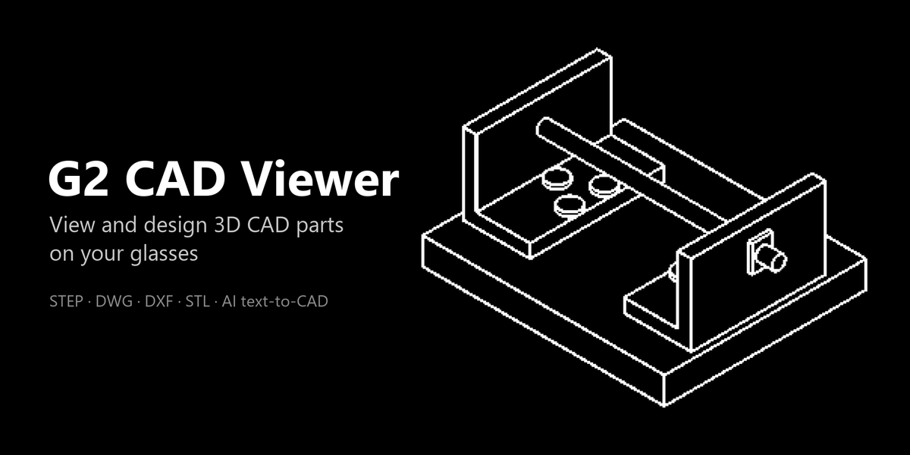
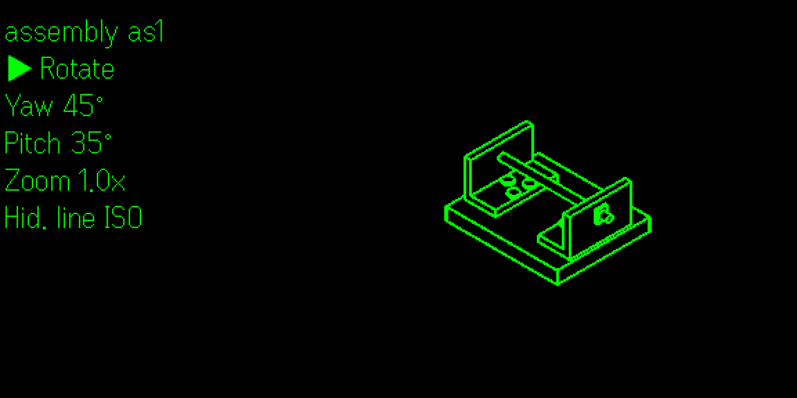
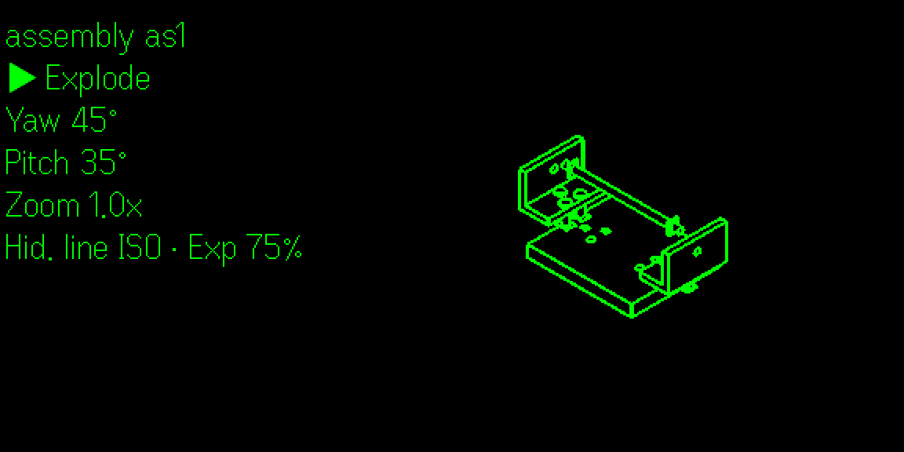
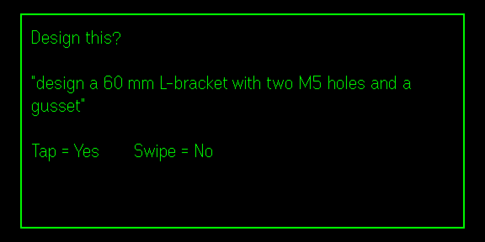
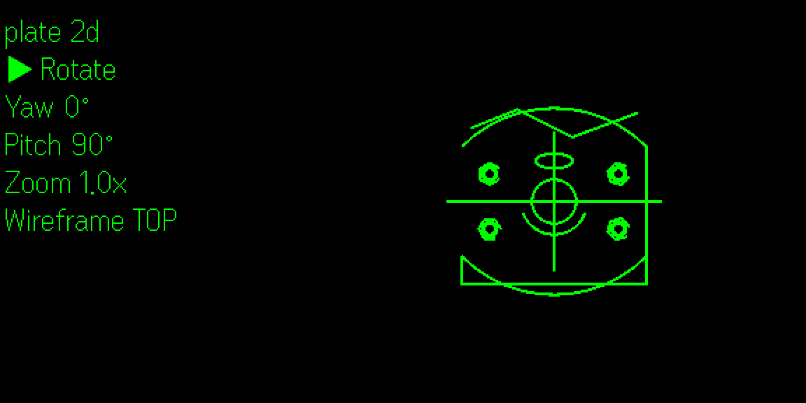

# G2 CAD Viewer

View, explore and **design** 3D CAD parts on [Even Realities G2](https://www.evenrealities.com/) smart glasses.

Open a CAD or 3D file on your phone, and the glasses show a crisp hidden-line drawing you can rotate, tilt, zoom, step through part by part, isolate, explode and turntable. Use the temple touchpad or your voice. Or hold the touchpad and say *"design a 60 mm L-bracket with two M5 holes"*: Claude writes the part as OpenSCAD code, your phone compiles it, and it appears on the glasses.



| On the glasses | |
|---|---|
|  |  |
|  |  |

| | |
|---|---|
| **Files** | STEP / IGES / BREP · DWG / DXF · GLB · STL · OBJ · PLY · 3MF · FBX |
| **Views** | Hidden-line, shaded, wireframe · iso / front / top / … · 1, 2 or 4 image tiles |
| **Glasses controls** | Tap = next mode · swipe = adjust · hold = talk · double-tap = exit |
| **AI design** | Text-to-CAD with Claude via *your own* Cloudflare Worker · auto-saved "My designs" · STL / .scad export |
| **Voice** | Push-to-talk with ElevenLabs or Deepgram (your own account) |

## Repository layout

| Folder | What it is |
|---|---|
| [`g2-cad-viewer/`](g2-cad-viewer) | The Even Hub app (Vite + TypeScript + three.js). Runs on the phone and draws to the glasses. |
| [`g2-cad-ai-worker/`](g2-cad-ai-worker) | A small Cloudflare Worker that keeps **your** API keys server-side: Claude for AI design, ElevenLabs voice tokens, temporary download links. |

## Getting started

```bash
cd g2-cad-viewer
npm install
npm run dev        # phone UI at http://localhost:5173
npm run simulate   # Even Hub glasses simulator
```

- **App details and controls:** [g2-cad-viewer/README.md](g2-cad-viewer/README.md)
- **AI design, voice and downloads, step by step:** [g2-cad-viewer/SETUP-AI.md](g2-cad-viewer/SETUP-AI.md)

**No keys are ever built into the app.** Each user enters their own Worker URL, token and speech settings in the app's Settings panel, stored only on their phone. API keys live only in each user's own Cloudflare Worker.

**Building your own copy?** Change `package_id` in `g2-cad-viewer/app.json` to your own reverse-domain ID before you pack or publish.

## Privacy and terms

[Privacy policy](PRIVACY.md) · [Terms of use](TERMS.md). In short: the developer collects nothing, and optional features talk only to services you set up yourself.

## Licence

GPL-3.0-or-later. See [COPYING](COPYING) and [g2-cad-viewer/LICENSE](g2-cad-viewer/LICENSE).

The app bundles GPL components: **LibreDWG** (via `@mlightcad/libredwg-web`, GPL-3.0) for DWG/DXF and **OpenSCAD** (via `openscad-wasm-prebuilt`, GPL-2.0-or-later) for AI designs. It also uses **OpenCascade** via `occt-import-js` (LGPL-2.1) and **three.js** (MIT). The project was scaffolded from Even Realities' [evenhub-templates](https://github.com/even-realities/evenhub-templates).

Sample model `assembly-as1.stp` is a CAx-IF test file, as distributed with `occt-import-js`.
